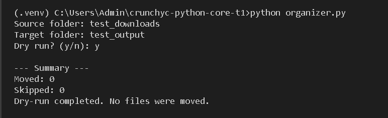
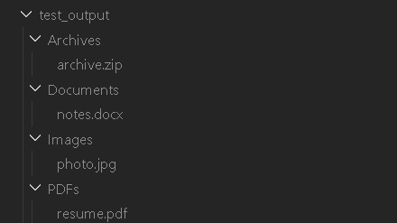

# Smart Downloads Folder Organizer 📂

A Python automation tool that organizes files into folders based on their file extensions. It supports safe dry-run mode to preview file movements before executing them.

## 🚀 Features

- Automatically organizes files based on extensions
- Categorizes files into Images, PDFs, Documents, Archives, and Others
- Dry-run mode to preview file movements
- Prevents overwriting existing files
- Skips folders and processes files only
- Displays a summary of moved and skipped files
- Simple command-line interface
- Built using Python standard libraries

## 📁 Supported File Types

| Category | Extensions |
|---|---|
| Images | `.jpg`, `.jpeg`, `.png` |
| PDFs | `.pdf` |
| Documents | `.doc`, `.docx`, `.txt` |
| Archives | `.zip`, `.rar` |
| Others | All remaining extensions |

## 🛠️ Installation

### 1. Clone the Repository

```bash
git clone https://github.com/manisham1111/crunchyc-python-core-t1.git
```

### 2. Navigate to the Project

```bash
cd crunchyc-python-core-t1
```

### 3. Create Virtual Environment

```bash
python -m venv .venv
```

### 4. Activate Virtual Environment

Windows CMD:

```cmd
.venv\Scripts\activate
```

### 5. Install Dependencies

```bash
pip install -r requirements.txt
```

No external dependencies are required.

## ▶️ How to Run

Execute the Python script:

```bash
python organizer.py
```

Enter the source and target folder paths when prompted.

## 🧪 Dry Run Example

Dry-run mode previews file movements without modifying files.

```text
Source folder: test_downloads
Target folder: test_output
Dry run? (y/n): y

[DRY RUN] archive.zip -> Archives
[DRY RUN] notes.docx -> Documents
[DRY RUN] photo.jpg -> Images
[DRY RUN] resume.pdf -> PDFs

--- Summary ---
Moved: 0
Skipped: 0

Dry-run completed. No files were moved.
```

Enter `y` to preview and `n` to move files.

## 📸 Screenshots

### Dry Run Preview



### Organized Output



## 💻 Tech Stack

- Python 3.12+
- pathlib
- shutil

## 📌 Project Purpose

This project demonstrates Python automation, file handling, directory management, and safe file organization using built-in Python libraries.

## 👩‍💻 Author

**Manisha M**

GitHub: [manisham1111](https://github.com/manisham1111)

---

⭐ If you find this project useful, consider giving it a star!

## 📸 Screenshots

### Dry Run Preview


### Organized Output
